> [!IMPORTANT]
> Remove this line to confirm you've reviewed this PR before submitting.

<p align="center">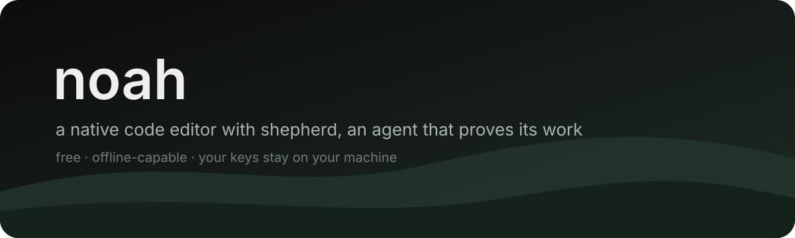</p>

# noah

## download

| platform | get it | notes |
|---|---|---|
| **windows** (x64) | [noah-windows-x86_64.exe](https://noah.asherin.com/downloads/noah-windows-x86_64.exe) | installer; see "this file might be a security risk" below |
| **linux** (x64) | [noah-linux-x86_64.tar.xz](https://noah.asherin.com/downloads/noah-linux-x86_64.tar.xz) · [.deb](https://noah.asherin.com/downloads/noah-linux-amd64.deb) | unpack and run `bin/noah`, or install the `.deb` |
| **macos** | not published yet | build from source for now |
| **ios / android** | not available | noah's interface framework (GPUI) only runs on desktop systems |
| **from source** | `cargo run --release` | any desktop system |

Each file has a `.sha256` next to it (add `.sha256` to the link) so you can check the download.

## capabilities, in order

<table>
<tr>
<td>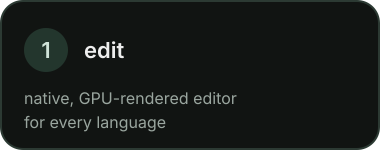</td>
<td>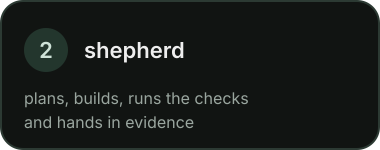</td>
<td>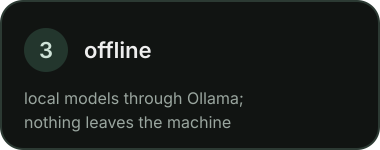</td>
</tr>
<tr>
<td>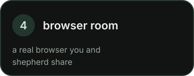</td>
<td>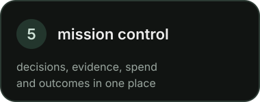</td>
<td>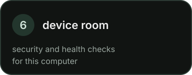</td>
</tr>
</table>

1. **edit**: a fast, native, GPU-rendered editor (a fork of Zed) with language servers, git and a terminal.
2. **shepherd**: the built-in agent. It plans, edits, runs the project's own checks and hands in evidence for each change.
3. **offline**: point shepherd at a local model through Ollama and nothing you type leaves the computer. Editing, git, the terminal and the device room need no network at all.
4. **browser room**: a real browser shepherd can read and click in while you watch, and take over at any time.
5. **mission control**: every conversation, the decisions waiting on you, evidence, spend and how past work held up.
6. **device room**: antivirus, firewall, encryption, updates, open ports, health and a system-wide ad blocker.

## screenshots

<p align="center">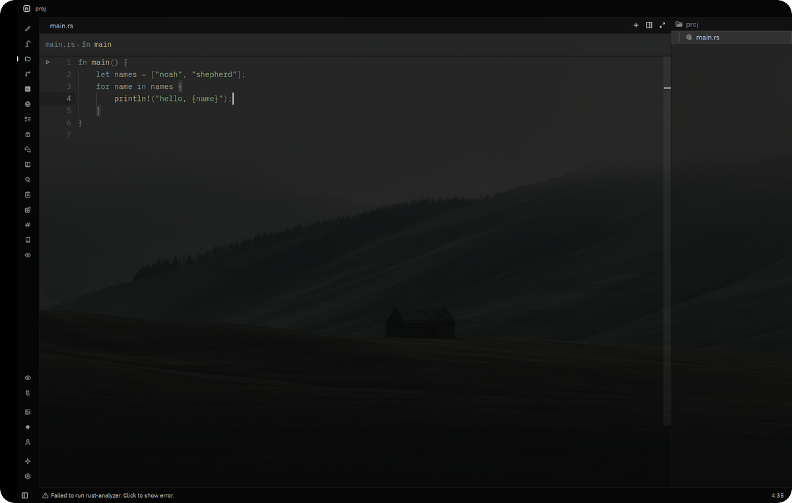</p>

<table>
<tr>
<td width="50%">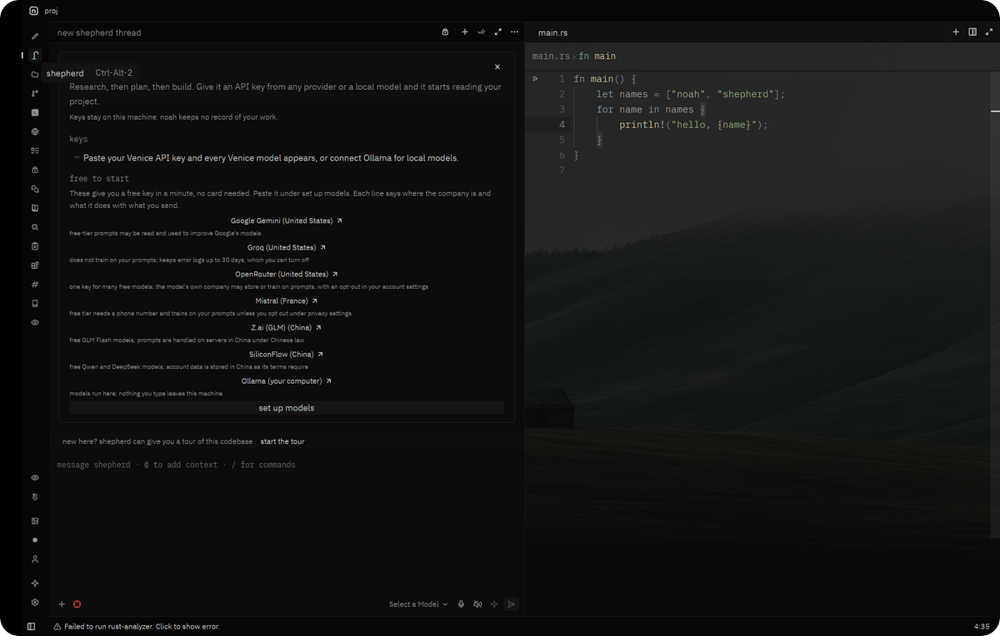<br><sub><b>shepherd</b>: set up any provider or a local model, then ask</sub></td>
<td width="50%">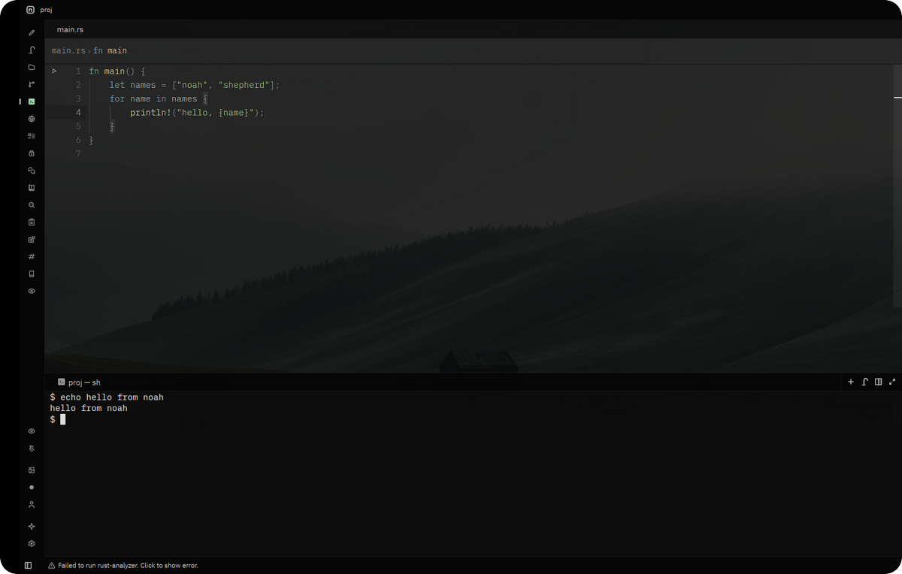<br><sub><b>terminal</b>: under the code, in the same window</sub></td>
</tr>
<tr>
<td width="50%">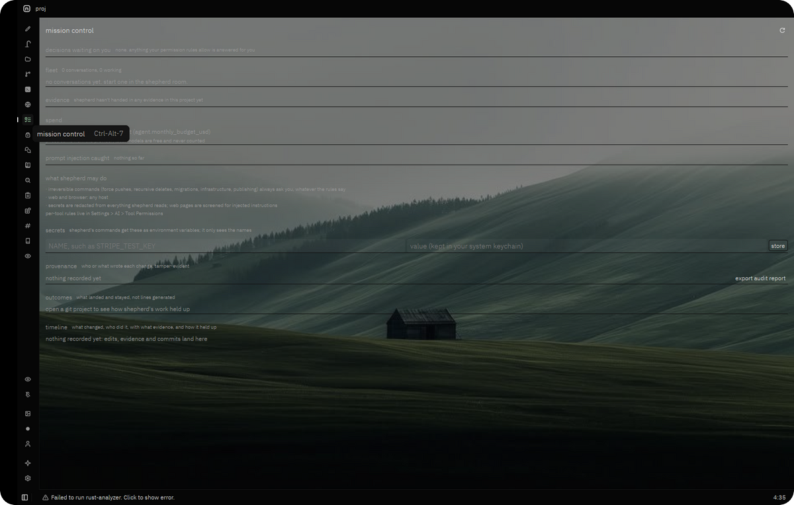<br><sub><b>mission control</b>: decisions, evidence, spend and outcomes</sub></td>
<td width="50%">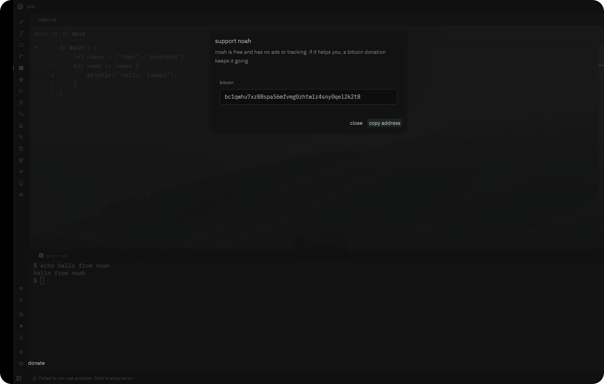<br><sub><b>donate</b>: the bitcoin address, one click to copy</sub></td>
</tr>
</table>

## how a change flows

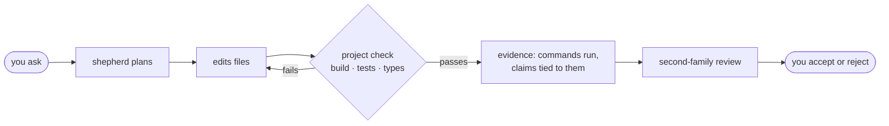

## how noah is put together

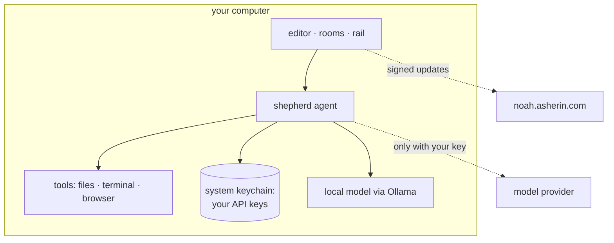

## offline

1. install [Ollama](https://ollama.com) and pull a model, for example `ollama pull qwen2.5-coder`.
2. in noah, open shepherd and choose **set up models**, then **Ollama (your computer)**.
3. pick the model in the model menu. shepherd now runs entirely on this machine.

Auto-update checks and web search need the network. When it isn't there they fail and say so, and nothing else stops working.

## donate

noah is free, with no ads and no tracking. If it helps you, a bitcoin donation keeps it going:

```
bc1qwhu7xz88spa56mfvmg0zhtwlr4sny0qel2k2t8
```

Inside noah, the **donate** button on the left rail shows the address with a copy button.

## more

**noah** is a fast, native code editor with a built-in AI pair-programmer called **shepherd**.
It is a fork of [Zed](https://github.com/zed-industries/zed), rebranded and extended by
**#houseofasher** / [asherin.com](https://asherin.com).

- Free to use. No paywall, no sign-up.
- Bring your own **Venice AI** API key — your key stays on your machine.
- **shepherd** reads your project's aesthetics, architecture, and code conventions, then
  matches your patterns.
- Custom editor wallpaper: the UI palette adapts to the image you choose.
- A real browser inside noah: shepherd can open pages, read them, click and fill forms, and you
  watch it live in the browser room (ctrl-alt-6) and can take over at any time.
- Every language: pick yours in Settings > General > Language; noah's interface and shepherd
  switch to it.
- Proof over claims: shepherd hands in evidence with each change (the commands that really ran,
  each claim tied to them, what it didn't verify), and a model from another family reviews it.
- Guard rails: prompt injection in web pages is withheld, secrets are redacted, irreversible
  commands always ask, new dependencies are checked against their registries, and every change
  is recorded in a tamper-evident provenance log.
- Mission control (ctrl-alt-7): every conversation, the decisions waiting on you, evidence,
  spend against your budget, and how shepherd's past work held up.
- Voice: speak to shepherd and hear its replies, through your own provider's API key.
- Preview: "preview this file in the browser" (in the settings menu on the left rail) shows an
  HTML, SVG, PDF or image file in the browser room and reloads it on every save; type
  `localhost:3000` there to see your dev server.
- Keys stay yours: API keys live in your system keychain, never in settings or your project, and
  committing from noah warns you before a key or password in your changes reaches GitHub.
- No Git on Windows? Cloning a repository downloads the official portable Git for Windows
  (checksum-verified) the first time it's needed.
- asherin.chat (rail): think with shepherd outside any project. Chat threads can talk, search
  the web and read, but can't edit files or run commands.
- asherin.pages (rail): describe a PDF, a digital book or a slideshow and shepherd makes it,
  previews it live and exports it.
- Chat history: the sidebar groups chats by project; pin chats and projects, drag to reorder.
- Device room: security checks (antivirus, firewall, encryption, updates, remote access, open
  ports), health, what starts with the computer, a duplicate-file finder that keeps the newest
  copy, and an ad blocker for every app through the hosts file.
- Web search with sources, and a reasoning level (low, medium, high) for models that think.
- Bring a key for nearly 50 providers: OpenAI, Anthropic, Google, Mistral, xAI, DeepSeek, Groq, Together,
  Fireworks, Perplexity, Cerebras, Qwen, Kimi, GLM, MiniMax, Doubao, Hunyuan and more, or run
  models locally.
- Pin any app or page you build to the rail and switch back to it in one click.
- Updates are signed with noah's release key and checked before they install.

### "This file might be a security risk"

When you download or open noah, your browser or Windows may warn you that the file is
unrecognised, from an unknown publisher, or "might harm your computer". The file is not
harmful. The warning appears because noah is not code-signed, and code-signing is something you
pay for. Here is who is saying it, from the surface down to the root:

1. **Your browser** (Chrome, Edge, Firefox). It shows "this file isn't commonly downloaded" or
   "may be dangerous". It is not scanning the file for anything; it is asking a reputation
   service (Google Safe Browsing, or Microsoft SmartScreen inside Edge) whether it has seen this
   exact file, from this publisher, downloaded many times before. A new release of a small
   program has no history, so the answer is no.
2. **Windows SmartScreen**, when you run the installer: "Windows protected your PC. Unknown
   publisher." Windows looks for a digital signature on the .exe. Ours has none, so it cannot
   name a publisher, and it treats a program it cannot name as suspect. Click "More info", then
   "Run anyway".
3. **The signature itself.** A signature needs a code-signing certificate, which only a
   certificate authority can issue: DigiCert, Sectigo, GlobalSign, SSL.com, Certum and a few
   others. A standard one costs a few hundred dollars a year, and SmartScreen still warns until
   it has built up reputation. An "extended validation" one skips the warning immediately, costs
   more, is delivered on a hardware key, and requires a registered company to be checked by the
   authority first.
4. **The root: Microsoft's Trusted Root Program.** Windows trusts a certificate only if it chains
   to an authority Microsoft has admitted to this program. Those authorities are the businesses in
   step 3. The same shape exists on macOS, where Apple charges a developer fee and notarises each
   build itself.

So the chain is: a browser and an operating system that decide trust by signature and download
count; certificate authorities that sell the signature; and Microsoft and Apple, who decide which
authorities count. Nowhere in that chain does anyone look at what the program does. Signed
malware exists, and unsigned honest software gets warned about every day. The warning tells you
that nobody has paid to vouch for the file. That is all it tells you.

If you would rather check for yourself than click through a warning, you can:

- Compare the file's SHA-256 with the one printed on the download page. If they match, the file
  is the one we published.
- Read the source, here, and build it yourself (below). That is the only real proof, and it is
  the reason noah is open.

We intend to sign releases once the certificate is paid for. Until then the warning will show,
and this section is here so you know why.

Linux has no such gate. The .deb and the .tar.xz install without a warning, though a browser may
still flag the download by the same reputation logic as step 1.

Community: [Discord](https://discord.gg/M9hnebRwvk) · [asherin.com](https://asherin.com)

---

### Building noah

noah is a native desktop application built in Rust on the GPUI framework. It is **not** a web
app and is not deployed to a web host — it ships as a downloadable binary for macOS, Linux,
and Windows.

Follow the upstream Zed development docs for your platform (the toolchain is identical):

- [macOS](./docs/src/development/macos.md)
- [Linux](./docs/src/development/linux.md)
- [Windows](./docs/src/development/windows.md)

Quick start once the toolchain is set up:

```sh
# Run the editor (debug)
cargo run -p zed

# Release build
cargo build --release -p zed
```

> The Rust crate is still named `zed` internally (renaming 247 crates would gain nothing and
> break every internal path); the **product** you see — window title, About dialog, app
> bundle — is **noah**.

### Credit

noah stands on the shoulders of [Zed](https://zed.dev) by Zed Industries, licensed under
GPL-3.0 / Apache-2.0. See `LICENSE-GPL` and `LICENSE-APACHE`. This fork retains those licenses.

shepherd's browser is [agent-browser](https://github.com/vercel-labs/agent-browser) by Vercel
Labs, Apache-2.0. noah's installers include its binary unchanged, with its license alongside
(`script/fetch-agent-browser` pins and verifies the release).
